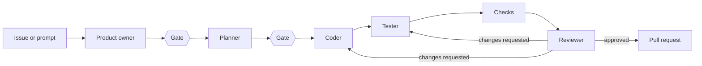

# agent-conductor

Orchestrates AI agents on top of [OpenCode](https://opencode.ai) to implement features.
A feature request goes through a fixed team of agents — product owner, planner, coder,
tester and reviewer — with a configurable review loop. The result is a pull request.

> **Status:** early development (phase 2 of 6: local runs). conductor can run locally on
> a branch (`--no-pr`); pull requests and GitHub Actions follow. See the
> [project plan](docs/PLAN.md) (German).

## How it works

- **Product owner** turns an issue or prompt into requirements, acceptance criteria and
  open questions.
- **Planner** writes an implementation plan.
- **Coder** implements, then **tester** adds tests and guardrails (lint rules,
  architecture rules, CI checks).
- **Checks** — your test, lint and build commands — are run by conductor itself, not by
  the agents.
- **Reviewer** returns a structured verdict and routes findings back to coder and/or
  tester until it approves or a limit (iterations, time, cost) is reached.
- **Gates** let a human approve or revise requirements and plan: in the terminal when
  running locally, through pull request reviews in GitHub Actions.

Agents never touch git. conductor creates the branch, commits, squashes and opens the
pull request, and verifies after every phase that no agent changed the repository
history. The coder cannot modify the tests and rules the tester created.

conductor runs the same way locally (in a devcontainer) and in GitHub Actions.

## Documentation

| You want to…                     | Read                                                                                       |
| -------------------------------- | ------------------------------------------------------------------------------------------ |
| Understand how conductor works   | [Concepts](docs/guide/concepts.md)                                                         |
| Run conductor locally            | [Running locally](docs/guide/local-usage.md)                                               |
| Configure conductor              | [Configuration reference](docs/guide/configuration.md)                                     |
| Understand the decisions         | [Architecture decision records](docs/adr)                                                  |
| See the roadmap                  | [Project plan](docs/PLAN.md) (German)                                                      |
| Contribute                       | [CONTRIBUTING.md](CONTRIBUTING.md)                                                         |
| Work on this repo with AI agents | [Working with agents](docs/contributing/working-with-agents.md) and [AGENTS.md](AGENTS.md) |

A getting-started guide for GitHub Actions follows with phases 3 and 4.

## License

Not yet decided. Until then, all rights reserved.
