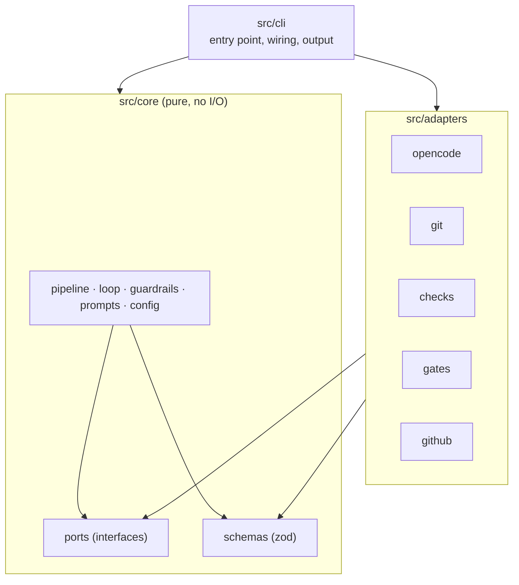
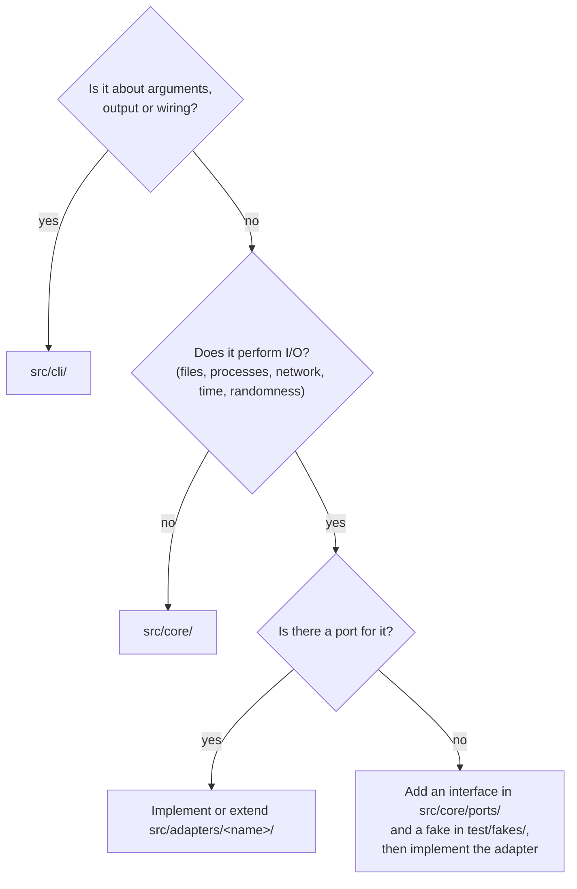

# Architecture

agent-conductor uses a ports-and-adapters (hexagonal) architecture. The rules below are
enforced by dependency-cruiser (`bun run arch`); the reasoning is in
[ADR 0009](../adr/0009-ports-and-adapters.md).

> Status: `src/core/` (phase 1) and `src/cli/` exist. Phase 2 of the [plan](../PLAN.md)
> adds the adapters: `src/adapters/opencode/`, `src/adapters/git/`,
> `src/adapters/checks/`, `src/adapters/terminal/` and `src/adapters/store/` exist.

## Layers

| Layer             | Responsibility                                                                                                        | May import                              |
| ----------------- | --------------------------------------------------------------------------------------------------------------------- | --------------------------------------- |
| `src/core/`       | Orchestration logic: state machine, review loop, limits, guardrail policy, prompt assembly, config                    | other core modules, `zod`, `node:path`  |
| `src/core/ports/` | Interfaces for every side effect (`AgentRunner`, `Vcs`, `CheckRunner`, `GateHandler`, `Forge`, `Clock`, `StateStore`) | core types                              |
| `src/adapters/x/` | Implement one port each, talk to the outside world                                                                    | `core/ports`, `core/schemas`, libraries |
| `src/cli/`        | Parse arguments, build adapters, call core, print output                                                              | everything                              |
| `test/fakes/`     | In-memory implementations of ports for tests                                                                          | `core`                                  |

Forbidden everywhere: circular dependencies, imports from `test/` into `src/`, dev
dependencies in shipped code.

## Where does my code go?

Rules of thumb:

- Decisions belong in core; the adapter only executes them. Example: core decides which
  files to revert after a guardrail violation; the git adapter performs the revert.
- Time and randomness are side effects too. Use the `Clock` port instead of `new Date()`
  in core.
- Adapters do not call each other. If two adapters need to cooperate, core orchestrates
  them.
- Validate everything that crosses the boundary (config files, agent output, API
  responses) with the zod schemas in `src/core/schemas/`.

## Runtime

The published package targets Node.js ≥ 22.12 and may only use `node:*` APIs. Bun is
used to install, run scripts and bundle ([ADR 0002](../adr/0002-typescript-node-runtime-bun-tooling.md)).
OpenCode is driven through `@opencode/client` and a private server started by conductor
([ADR 0012](../adr/0012-opencode-v2-client-and-private-server.md)).

## Check runner

`src/adapters/checks/` implements the `CheckRunner` port:

- Each check runs as a shell command in the target repository with `CI=true`,
  `NO_COLOR=1` and `FORCE_COLOR=0`, so tools print plain, non-interactive output.
- stdout and stderr are collected together. Colors are stripped, and output longer than
  20,000 characters is shortened: a quarter of the budget keeps the beginning, the rest
  keeps the end, where failures usually show.
- On timeout, the whole process group is killed (including child processes such as test
  workers). The result has `timedOut: true`, `exitCode: null` and a note in the output.

## Terminal gate

`src/adapters/terminal/` implements the `GateHandler` port for local runs:

- At a gate it prints the artifact and asks: approve, revise with feedback typed in the
  terminal (finished by an empty line), revise with feedback written in the editor
  (`$VISUAL`, then `$EDITOR`, then `vi`; lines starting with `#` are ignored), or abort
  with an optional reason.
- At a limit (`loop.onLimit: ask`) it asks: continue, draft PR or abort.
- Unknown answers and empty feedback lead to the question being asked again. If the input
  ends (for example Ctrl-D), the run is aborted.
- The adapter takes its input and output streams as options and does not use `console`;
  the CLI will pass `process.stdin` and `process.stderr` and call `close()` at the end.

## CLI

`src/cli/` parses arguments and wires the adapters into core:

- `config-file.ts` reads `conductor.yaml` (YAML via the `yaml` package) and validates it
  with the core schema.
- `engine-setup.ts` builds the engine context for local runs: git, shell checks,
  terminal gate and reporter, file run store, a no-op publisher and a private OpenCode
  server. It closes the gate and stops the server when the command ends.
- `commands/` holds one file per subcommand. `run` and `resume` take the agent runtime as
  a parameter, so tests replace OpenCode with a scripted runner and use a real temporary
  repository for everything else.

## Run store

`src/adapters/store/` implements the `RunStore` port with plain files (plan 7.3):

- An active run lives in `.conductor/runs/<run-id>/` in the target repository:
  `state.json` (pretty-printed, validated with `runStateSchema` on load) next to the
  artifacts (`requirements.md`, `plan.md`, `review-<n>.json`).
- Files are written to a temporary file first and then renamed, so an interrupted run
  never leaves a half-written state behind.
- `archive` moves the run directory to the archive directory (locally
  `~/.local/share/agent-conductor/runs/`). From then on, all reads and writes for that run
  use the archive. Emptied `.conductor/runs/` and `.conductor/` directories are removed.
- If the archive location is not writable, the adapter reports the path, asks the user to
  check its ownership and permissions, and suggests setting `XDG_DATA_HOME` elsewhere.
- Run IDs and artifact names are checked against strict patterns, so no path can leave
  the run directory.

## Git adapter

`src/adapters/git/` implements the `Vcs` port with the `git` command line
([ADR 0006](../adr/0006-git-only-by-framework.md)):

- `changedFiles` and `diff` include untracked files. They stage everything into a
  temporary index (`GIT_INDEX_FILE`), so the real index stays untouched.
- `revertPaths` restores files from the given commit and deletes files that did not exist
  there. Paths are taken literally, not as globs.
- `commit` and `squash` stage all changes and also create empty commits. The target
  repository's commit hooks run; intermediate commits use `chore(conductor): …` messages.
- `integritySnapshot` hashes HEAD, the checked-out branch, all refs, the repository
  config and the hooks directory (plan 5.3).
- `push` uses `--force-with-lease`, so commits that conductor has not seen are never
  overwritten.

## OpenCode adapter

`src/adapters/opencode/` implements the `AgentRunner` port:

- `server.ts` starts `opencode serve --hostname 127.0.0.1 --port 0` in the target
  repository. It sets a random `OPENCODE_SERVER_PASSWORD`, reads the URL from the
  `server listening on …` line and stops the process when the run ends. The `opencode`
  binary must be on `PATH`.
- `runner.ts` creates one session per agent run with the `build` agent, the role's model
  and permission ruleset, or continues an existing session and replaces its rules. It
  opens the event stream first, then sends the role instructions and the task as one
  prompt, and waits until the execution ends.
- `watch.ts` follows the session's events. Every `permission.asked` is rejected, because
  nobody can answer during a run. Rejected requests are reported in the result's `error`.
- When the timeout expires, the adapter interrupts the session and reports `timeout`.
  The cost is the session cost after the run minus the cost before it.
