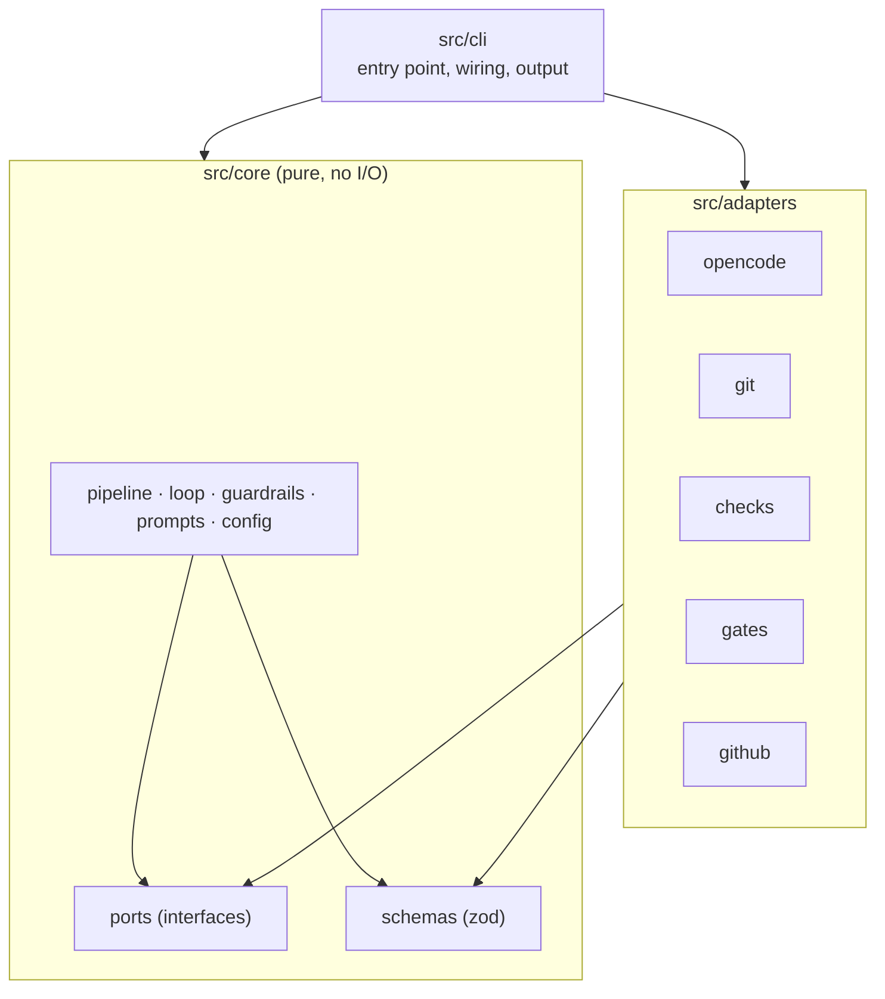
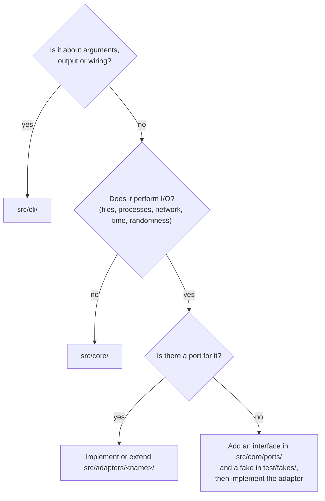

# Architecture

agent-conductor uses a ports-and-adapters (hexagonal) architecture. The rules below are
enforced by dependency-cruiser (`bun run arch`); the reasoning is in
[ADR 0009](../adr/0009-ports-and-adapters.md).

> Status: only `src/cli/` exists so far. `core` and `adapters` are introduced in phases
> 1 and 2 of the [plan](../PLAN.md).

## Layers

| Layer             | Responsibility                                                                                                        | May import                              |
| ----------------- | --------------------------------------------------------------------------------------------------------------------- | --------------------------------------- |
| `src/core/`       | Orchestration logic: state machine, review loop, limits, guardrail policy, prompt assembly, config                    | other core modules, `zod`, `node:path`  |
| `src/core/ports/` | Interfaces for every side effect (`AgentRunner`, `Vcs`, `CheckRunner`, `GateHandler`, `Forge`, `Clock`, `StateStore`) | core types                              |
| `src/adapters/x/` | Implement one port each, talk to the outside world                                                                    | `core/ports`, `core/schemas`, libraries |
| `src/cli/`        | Parse arguments, build adapters, call core, print output                                                              | everything                              |
| `test/fakes/`     | In-memory implementations of ports for tests                                                                          | `core`                                  |

Forbidden everywhere: circular dependencies, imports from `test/` into `src/`, dev
dependencies in shipped code.

## Where does my code go?

Rules of thumb:

- Decisions belong in core; the adapter only executes them. Example: core decides which
  files to revert after a guardrail violation; the git adapter performs the revert.
- Time and randomness are side effects too. Use the `Clock` port instead of `new Date()`
  in core.
- Adapters do not call each other. If two adapters need to cooperate, core orchestrates
  them.
- Validate everything that crosses the boundary (config files, agent output, API
  responses) with the zod schemas in `src/core/schemas/`.

## Runtime

The published package targets Node.js ≥ 22.12 and may only use `node:*` APIs. Bun is
used to install, run scripts and bundle ([ADR 0002](../adr/0002-typescript-node-runtime-bun-tooling.md)).
OpenCode is driven through its SDK and a server started by conductor
([ADR 0003](../adr/0003-opencode-sdk-and-server.md)).
