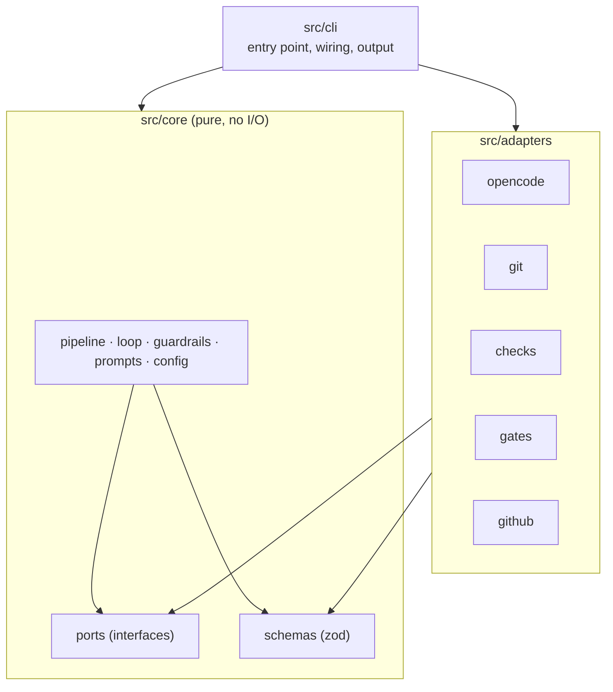
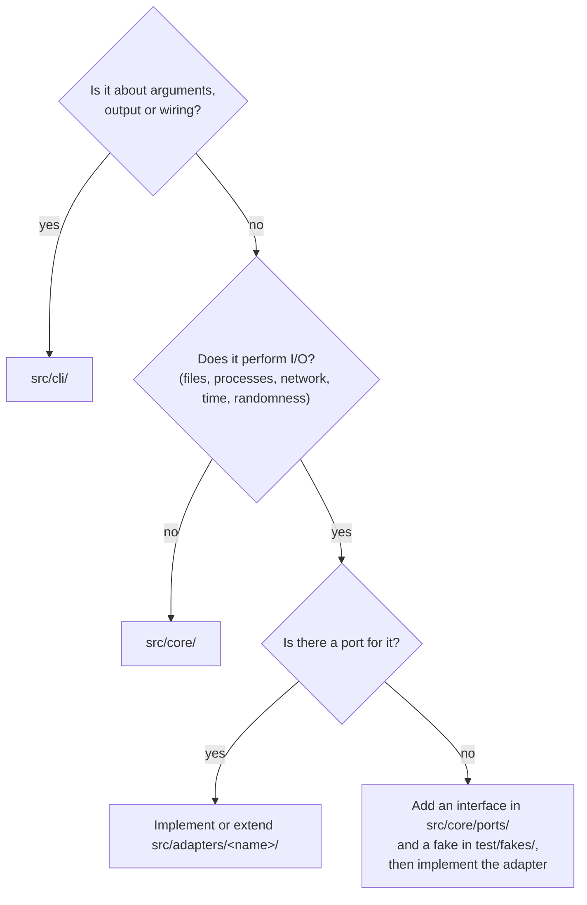

# Architecture

agent-conductor uses a ports-and-adapters (hexagonal) architecture. The rules below are
enforced by dependency-cruiser (`bun run arch`); the reasoning is in
[ADR 0009](../adr/0009-ports-and-adapters.md).

> Status: `src/core/` (phase 1) and `src/cli/` exist. Phase 2 of the [plan](../PLAN.md)
> adds the adapters, starting with `src/adapters/git/`.
> adds the adapters; `src/adapters/opencode/` is the first one.

## Layers

| Layer             | Responsibility                                                                                                        | May import                              |
| ----------------- | --------------------------------------------------------------------------------------------------------------------- | --------------------------------------- |
| `src/core/`       | Orchestration logic: state machine, review loop, limits, guardrail policy, prompt assembly, config                    | other core modules, `zod`, `node:path`  |
| `src/core/ports/` | Interfaces for every side effect (`AgentRunner`, `Vcs`, `CheckRunner`, `GateHandler`, `Forge`, `Clock`, `StateStore`) | core types                              |
| `src/adapters/x/` | Implement one port each, talk to the outside world                                                                    | `core/ports`, `core/schemas`, libraries |
| `src/cli/`        | Parse arguments, build adapters, call core, print output                                                              | everything                              |
| `test/fakes/`     | In-memory implementations of ports for tests                                                                          | `core`                                  |

Forbidden everywhere: circular dependencies, imports from `test/` into `src/`, dev
dependencies in shipped code.

## Where does my code go?

Rules of thumb:

- Decisions belong in core; the adapter only executes them. Example: core decides which
  files to revert after a guardrail violation; the git adapter performs the revert.
- Time and randomness are side effects too. Use the `Clock` port instead of `new Date()`
  in core.
- Adapters do not call each other. If two adapters need to cooperate, core orchestrates
  them.
- Validate everything that crosses the boundary (config files, agent output, API
  responses) with the zod schemas in `src/core/schemas/`.

## Runtime

The published package targets Node.js ≥ 22.12 and may only use `node:*` APIs. Bun is
used to install, run scripts and bundle ([ADR 0002](../adr/0002-typescript-node-runtime-bun-tooling.md)).

## Git adapter

`src/adapters/git/` implements the `Vcs` port with the `git` command line
([ADR 0006](../adr/0006-git-only-by-framework.md)):

- `changedFiles` and `diff` include untracked files. They stage everything into a
  temporary index (`GIT_INDEX_FILE`), so the real index stays untouched.
- `revertPaths` restores files from the given commit and deletes files that did not exist
  there. Paths are taken literally, not as globs.
- `commit` and `squash` stage all changes and also create empty commits. The target
  repository's commit hooks run; intermediate commits use `chore(conductor): …` messages.
- `integritySnapshot` hashes HEAD, the checked-out branch, all refs, the repository
  config and the hooks directory (plan 5.3).
- `push` uses `--force-with-lease`, so commits that conductor has not seen are never
  overwritten.

## OpenCode adapter

OpenCode is driven through its SDK and a server started by conductor
([ADR 0003](../adr/0003-opencode-sdk-and-server.md)).

OpenCode is driven through `@opencode/client` and a private server started by conductor
([ADR 0012](../adr/0012-opencode-v2-client-and-private-server.md)).

`src/adapters/opencode/` implements the `AgentRunner` port:

- `server.ts` starts `opencode serve --hostname 127.0.0.1 --port 0` in the target
  repository. It sets a random `OPENCODE_SERVER_PASSWORD`, reads the URL from the
  `server listening on …` line and stops the process when the run ends. The `opencode`
  binary must be on `PATH`.
- `runner.ts` creates one session per agent run with the `build` agent, the role's model
  and permission ruleset, or continues an existing session and replaces its rules. It
  opens the event stream first, then sends the role instructions and the task as one
  prompt, and waits until the execution ends.
- `watch.ts` follows the session's events. Every `permission.asked` is rejected, because
  nobody can answer during a run. Rejected requests are reported in the result's `error`.
- When the timeout expires, the adapter interrupts the session and reports `timeout`.
  The cost is the session cost after the run minus the cost before it.
