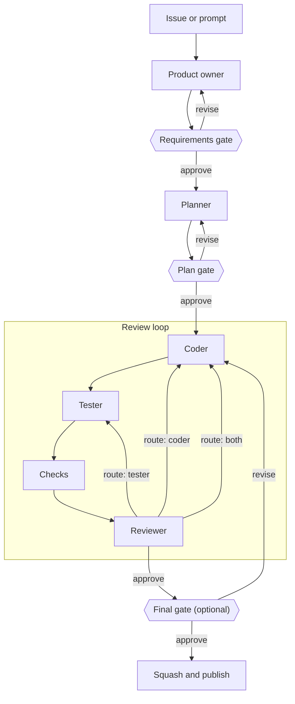
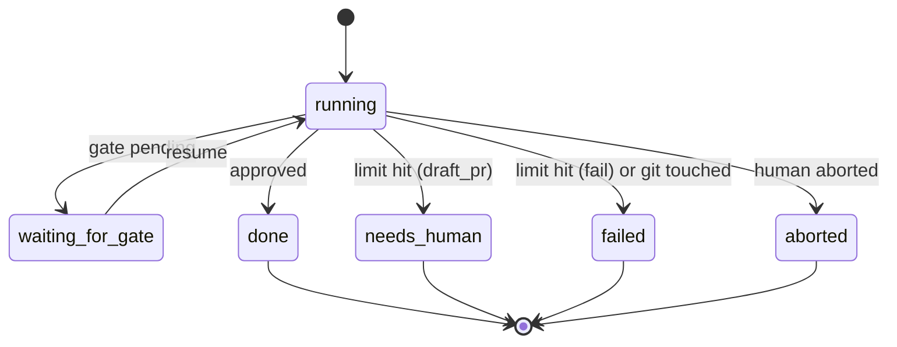

# Concepts

agent-conductor implements a feature by running a fixed team of AI agents on top of
[OpenCode](https://opencode.ai). This page explains the moving parts. For the settings,
see the [configuration reference](configuration.md).

> Status: the pipeline logic exists (phase 1). Running it against a real repository
> follows in phase 2.

## The pipeline

Every run gets its own branch (`conductor/<run-id>-<title>`). The phases are fixed; what
you configure is how they behave.

## Roles

| Role          | Does                                                                        | May                                   |
| ------------- | --------------------------------------------------------------------------- | ------------------------------------- |
| Product owner | Turns the request into requirements, acceptance criteria and open questions | Read the repository, browse the web   |
| Planner       | Writes an implementation plan, including which guardrails to add            | Read the repository, browse the web   |
| Coder         | Implements the plan                                                         | Edit files, run commands (except git) |
| Tester        | Adds tests and guardrails: lint, type and architecture rules, CI checks     | Edit files, run commands (except git) |
| Reviewer      | Checks the result and answers with a structured verdict                     | Read the repository                   |

Each role gets built-in instructions. You can add project-specific instructions or replace
them per role, choose a model per role and add permission rules. Some rules are fixed for
every agent and cannot be overridden: **no `git` or `gh`**, no subagents, no questions to
a human, no reading `.env` files and no access outside the repository.

## Documents

The product owner and planner produce `requirements.md` and `plan.md`. Together with
the reviewer's verdicts (`review-<n>.json`) they are stored in `.conductor/runs/<run-id>/`
on the branch while the run is active. At the end they move into the pull request
description, and the folder is removed from the branch.

## Gates

A gate pauses the run so a human can check the requirements or the plan before
implementation starts. Both gates are on by default. A human can:

- **approve** — the run continues,
- **revise** with feedback — the phase runs again with the previous document and the
  feedback,
- **abort** the run.

Locally, the gate is a prompt in the terminal; feedback can be typed there or written in
your editor (see [Running locally](local-usage.md#gates)). In GitHub Actions, the run
publishes a draft pull request, stops and continues when the pull request is approved
(or labeled `conductor:approved`); requested changes become the feedback. Time spent
waiting at a gate does not count towards the time limit.

The optional **final gate** (`gates.final`, off by default) pauses after the reviewer has
approved and all required checks pass. It shows the reviewer's summary, the check results
and the changed files. **Approve** finishes the run. **Revise** turns the feedback into a
finding for the coder and starts another iteration with coder and tester; the reviewer is
asked to verify that the feedback was addressed. **Abort** stops the run. As at the other
gates, the feedback can be typed in the terminal or written in the editor. Iterations
started this way do not count towards the iteration limit; cost and time limits still
apply.

## The review loop

1. **Coder** implements. In later iterations it receives the findings addressed to it
   and the failed checks.
2. **Tester** adds tests and guardrails. In later iterations it receives the findings
   addressed to it.
3. **Checks** — the commands you configure, such as tests, lint and build — are run by
   conductor itself, not by an agent.
4. **Reviewer** answers with JSON: `approve` or `changes_requested`, a `route` (`coder`,
   `tester` or `both`) and findings, each with a target. If the answer is not valid JSON
   in this format, the reviewer is asked again in the same session, up to three
   attempts in total.

The reviewer cannot approve while a **required** check fails; conductor turns such an
approval into a change request for the coder.

After approval, conductor squashes all commits into one and publishes the pull request.

## Guardrails

conductor protects what makes the result trustworthy:

- **Git is off-limits for agents.** Besides denying `git` and `gh`, conductor compares a
  fingerprint of the repository's history, branch, refs, configuration and hooks before
  and after every agent. Any change stops the run immediately.
- **The coder cannot weaken tests or rules.** Files matching `guardrails.paths` and
  every file the tester created or changed are protected. If the coder changes them,
  conductor reverts the change and reports it to the reviewer and back to the coder.
- **Framework files are protected.** No agent may change `.conductor/`.
- **Agents cannot escape their permissions.** Subagents are denied because OpenCode
  gives them their own permissions instead of the session's. Questions to a human are
  denied because nobody can answer during a run; if OpenCode still asks for a
  permission, conductor rejects the request.

## Limits

| Limit      | Default | Counts                                                                        |
| ---------- | ------- | ----------------------------------------------------------------------------- |
| Iterations | 3       | Review rounds without approval, not counting rounds started by human feedback |
| Cost       | $10     | Model cost reported by OpenCode                                               |
| Total time | 2 h     | Time spent working, not waiting at gates                                      |
| Phase time | 20 min  | One agent session                                                             |

When a limit is hit, or an agent fails or times out, `loop.onLimit` decides:

- `draft_pr` (default) — publish what exists as a draft pull request labeled
  `conductor:needs-human`, with the open findings in the description,
- `fail` — stop without publishing; the branch keeps its intermediate commits,
- `ask` — ask a human, who can grant another budget of the same size, ask for a draft
  pull request or abort. In CI, `ask` behaves like `draft_pr`.

## Run states

The run state is saved after every step, so an interrupted run can be resumed at the
step where it stopped.
